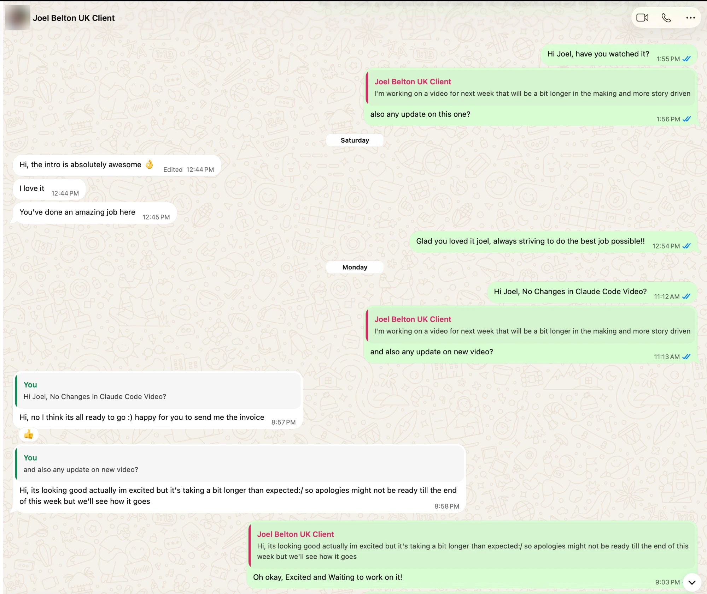
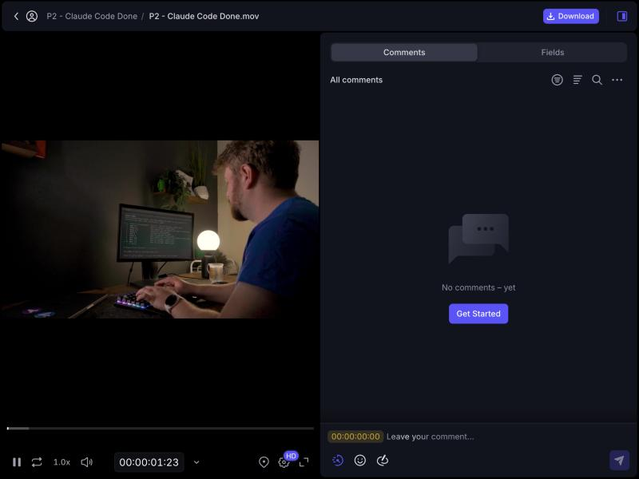
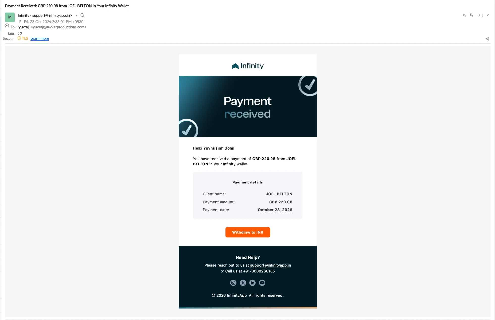

# P2 delivery, Joel's review and payment · Claude Code video · MergeToMaster

Delivered 15 Oct 2026 · accepted with no changes 19 Oct · paid 23 Oct (GBP 220.08).

Written 23 Oct 2026. Every figure is marked **measured** (read by a tool from a file or a page) or
**reconstructed** (read or counted by hand).

## The final video

**[Watch P2 on Frame.io: https://f.io/dBF09OXt](https://f.io/dBF09OXt)**

| Field | Value | How it was read |
|---|---|---|
| Short link | `https://f.io/dBF09OXt` | as given by Yuvraj |
| Resolves to | `https://next.frame.io/share/cf146418-d1f2-4907-9ed0-354870cea3f9/view/8c255e3a-c036-45d6-b27b-5429f0998ecb` | `curl -IL`, 23 Oct 2026, measured |
| Asset on the share page | `P2 - Claude Code Done.mov`, in "P2 - Claude Code Done", created 15 Oct 2026, 2:18 AM (browser local time, IST) | Frame.io Fields tab, 23 Oct 2026, measured |
| Duration on Frame.io | 666.36 s | the page's `<video>` element, measured |
| Local master | `Done/P2 - Claude Code Done.mov`, exported 15 Oct 2026, 02:00 IST | file time, measured |
| Local master SHA-256 | `7029f2311417bf611be9c6e88e6f768b104be7dd195b654e49f515ba761058da` | `shasum -a 256`, measured |
| Local master format | 3840×2160, 25/1 fps, H.264 + AAC, 666.36 s, 2,753,201,163 bytes | `ffprobe`, measured |

The share page shows no file size or hash, so the link is tied to the master by name, duration
(666.36 s on both) and upload time (18 minutes after the export), not by bytes.

## Joel's review, in his words

Joel did not comment on Frame.io. He answered on WhatsApp.



The profile photo is blurred for this public repository; nothing else in the image is changed.

| When (IST) | Who | Words, verbatim |
|---|---|---|
| before 17 Oct · 1:55 PM | Yuvraj | Hi Joel, have you watched it? |
| before 17 Oct · 1:56 PM | Yuvraj, quoting Joel's "I'm working on a video for next week…" | also any update on this one? |
| Sat 17 Oct · 12:44 PM (edited) | **Joel** | Hi, the intro is absolutely awesome 👌 |
| Sat 17 Oct · 12:44 PM | **Joel** | I love it |
| Sat 17 Oct · 12:45 PM | **Joel** | You've done an amazing job here |
| Sat 17 Oct · 12:54 PM | Yuvraj | Glad you loved it joel, always striving to do the best job possible!! |
| Mon 19 Oct · 11:12 AM | Yuvraj | Hi Joel, No Changes in Claude Code Video? |
| Mon 19 Oct · 11:13 AM | Yuvraj, quoting the same message | and also any update on new video? |
| Mon 19 Oct · 8:57 PM, replying to "No Changes in Claude Code Video?" | **Joel** | Hi, no I think its all ready to go :) happy for you to send me the invoice |
| Mon 19 Oct · 8:58 PM, replying to "any update on new video?" | **Joel** | Hi, its looking good actually im excited but it's taking a bit longer than expected:/ so apologies might not be ready till the end of this week but we'll see how it goes |
| Mon 19 Oct · 9:03 PM | Yuvraj | Oh okay, Excited and Waiting to work on it! |

Dates: the screenshot was taken on Friday 23 Oct 2026, so WhatsApp's "Saturday" divider is 17 Oct
and "Monday" is 19 Oct. The last message is about Joel's next video, not P2.



Frame.io, 23 Oct 2026: "No comments – yet" on the delivered file. A share link can hide reviewers'
comments depending on its settings, so this shows what the share page shows, not Frame.io's database.

## What it means (our reading, not Joel's words)

- **P2 accepted as delivered, with no changes, on 19 Oct 2026.** "no I think its all ready to go"
  answers "No Changes in Claude Code Video?".
- **The intro singled out** on 17 Oct: the opening as a whole, not one shot. A video-level keep.
- **No shot-level rulings.** He gave none, and he is not asked for any.
- **Invoice requested.** Billing, not a ruling. Paid on 23 Oct (below).

## Paid, 23 Oct 2026

Joel paid for P2 four days after accepting it.



| Field | Value, as the receipt shows it |
|---|---|
| From | JOEL BELTON |
| Amount | GBP 220.08 |
| Payment date | October 23, 2026 |
| Received in | Yuvrajsinh Gohil's Infinity wallet |
| Notice | email from Infinity `<support@infinityapp.in>`, Fri 23 Oct 2026, 2:33:01 PM +0530, subject "Payment Received: GBP 220.08 from JOEL BELTON in Your Infinity Wallet" |

Read by hand from the screenshot (reconstructed). The receipt does not name the video; that this
payment is for P2 is Yuvraj's statement: Joel asked for the P2 invoice on 19 Oct ("happy for you to
send me the invoice", above), and this is the payment that followed.

## Against the hypothesis

From [P2-HYPOTHESIS.md](../P2-HYPOTHESIS.md): *negative result if he changes more of our moments
than P1's rate or asks for fewer visuals again.*

| Measure | P1 | P2 |
|---|---|---|
| Moments Joel changed | 3 of 58 (5.2 %) | 0 (47 named moments planned) |
| Timestamped review notes | 66 on Frame.io | 0 on Frame.io; 0 change requests on WhatsApp |
| Asked for fewer visuals | no | no |
| His words | [joel-decisions.md](../design-system-snapshot/joel-decisions.md), 2026-09-14 and 2026-10-05 | above |

All reconstructed: P1 from its placement files ([CASE-STUDY §e](../CASE-STUDY.md#e-p1-baseline-reconstructed)), P2 from the messages above.
Neither kill condition fired. The other half of the measurement did not hold: AEM's time report
attributes no time to any single moment ([P2-STATUS.md](../P2-STATUS.md)), and the hand-made
baseline was dropped on 7 Oct.

## What AEM recorded, and what it did not

- AEM's first event for P2 is 6 Oct 2026; its last session or turn event is 15 Oct 2026, 02:23 IST,
  and tool calls are still observed on 23 Oct (measured, P2's `events.jsonl`). Its 7 `finish` events
  all close inferred stages between 7 and 10 Oct; none is a delivery.
- `approvals.jsonl` holds 2 lines: 1 approval (`cc_S00_agenda_v02`) and the line marking it stale
  when v03 replaced it. **The master went out with 0 standing approvals** (measured), and
  `events.jsonl` has no event for its delivery. The master was exported from Final Cut, and AEM
  observes only Claude Code and Codex sessions.
- **Joel's words are not in the ledger yet.** Only `aem client-said`, typed by the operator, writes
  the client's decisions file; the CLI refuses an agent by design. Until Yuvraj runs the commands
  below, the repository's [joel-decisions.md](../design-system-snapshot/joel-decisions.md) snapshot
  stays at its 9 Oct state on purpose.

```
/client-said --about video --ruling keep --source "WhatsApp, 19 Oct 2026" Hi, no I think its all ready to go :) happy for you to send me the invoice
/client-said --about video --source "WhatsApp, 17 Oct 2026" Hi, the intro is absolutely awesome 👌
```

- **`aem accept-video` cannot run on P2 as it stands.** It takes one version string, but P2's
  delivered moments sit at v01 to v06, and `moments/index.json` (built 9 Oct, placements empty)
  predates the delivery. One call would write implicit acceptances without a render SHA for most
  moments. It waits until AEM can accept "each moment's delivered render".

## Provenance of the images

| File | SHA-256 | Source |
|---|---|---|
| `whatsapp-2026-10-17-19.png` (this repo, avatar blurred) | `80867c99565af40d23b55c2e602c1464bfb6afdd63b470815a7b7cf18b4fa299` | made from the original below with Pillow: Gaussian blur on the 72 px avatar box only |
| Original screenshot, `.webp` (P2 folder, not published) | `0131380fa613d5a52ed6c460667b6d1e4724cf02b362475987c6ab43f0faa292` | pasted by Yuvraj into Claude Code, 23 Oct 2026; kept at P2 `reviews/joel/2026-10-19-whatsapp.webp` |
| `payment-2026-10-23.webp` (unedited) | `fc2e972dc3bb67925031592537cd4e82b65340848ebff6cb5bc51c19a8404713` | screenshot of Infinity's email, pasted by Yuvraj into Claude Code, 23 Oct 2026; also kept at P2 `reviews/joel/2026-10-23-payment-received.webp` |
| `frameio-2026-10-23.jpg` | `726a3fe34467a78e6aa3581749640a1b58b9f7839d87121843a8a8d7b438f6e0` | the share page in Claude's built-in browser, 23 Oct 2026 |
